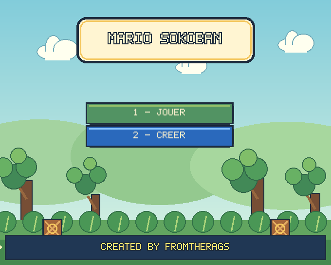
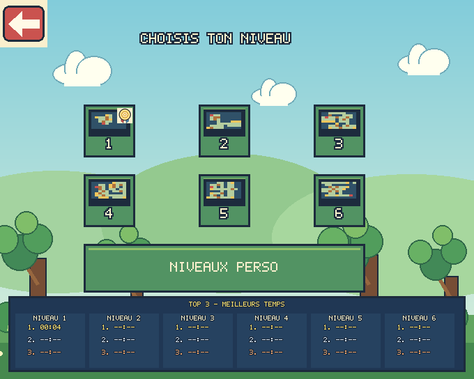
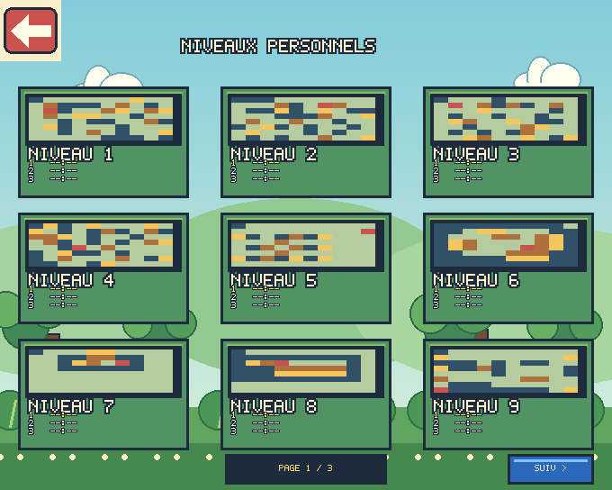
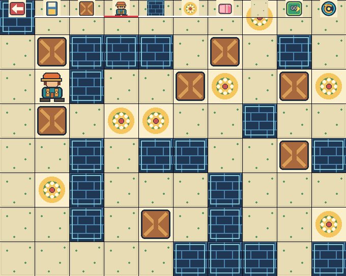

# Mario Sokoban – SDL 3

Cette branche est le portage SDL 3 du jeu de la branche `master` (SDL 1.2).
Les deux versions ont les mêmes menus, les mêmes graphismes et les mêmes textes :
le jeu est dessiné sur une surface de 680 × 544 avec les mêmes sprites et la
même police bitmap 5 × 7 (`bitmap_font.hpp`), puis affiché par le renderer
SDL 3, agrandi et centré dans la fenêtre. Aucune police ni SDL_ttf n’est
nécessaire. Les graphismes sont générés par `tools/generate_assets.py` et
dédiés au domaine public (CC0 1.0).


| Menu principal | Choix du niveau |
| --- | --- |
|  |  |
| **Niveaux personnels (3 pages de 9)** | **Éditeur de niveaux** |
|  |  |

Les captures sont identiques pour les versions SDL 1.2 et SDL 3.

## Téléchargements et intégration continue

Le workflow GitHub Actions (`.github/workflows/build.yml`) compile le jeu à
chaque push :

- **Linux** (Ubuntu 22.04, SDL 3 installé par `libsdl-org/setup-sdl`) :
  `mario-sokoban-sdl3-linux.tar.gz`. Décompressez-la, entrez dans le dossier
  `package` et lancez `./run.sh`.
- **Windows** (MSYS2 MinGW-w64, SDK SDL 3 officiel téléchargé par CMake) :
  `mario-sokoban-sdl3-windows.zip`, version portable (lancez
  `mario-sokoban.exe`), et `setup_mario_sokoban_sdl3-<version>.exe`, un
  installateur créé avec Inno Setup à partir de `installer/mario-sokoban.iss`.

Les fichiers sont disponibles dans les artefacts de chaque exécution. Pousser
un tag `sdl3-v<version>` (par exemple `sdl3-v1.6`) les publie aussi dans une
release GitHub ; le numéro de version est repris par l’installateur.

## Jouer

- `1 - JOUER` : six niveaux intégrés avec médaille et top 3 des meilleurs
  temps, et `NIVEAUX PERSO` pour jouer aux niveaux personnels.
- `2 - CREER` : l’éditeur. `MODIFIER` ouvre un emplacement (un emplacement vide
  démarre un nouveau niveau), `REINITIALISATION` vide un emplacement et efface
  sa médaille et ses temps. Dans l’éditeur : retour, sauvegarde, caisse,
  joueur, mur, objectif, gomme, sol, `GO` (tester le niveau, sans enregistrer
  de temps) et recharger la dernière sauvegarde du niveau.
- Les niveaux personnels sont rangés sur **3 pages de 9 niveaux** (27 niveaux),
  toujours disponibles : boutons `< PREC` / `SUIV >` ou flèches gauche/droite.
  Ils sont stockés dans `niveaux perso/niveau1.txt` … `niveau27.txt`, les
  temps et médailles dans `data/` (mêmes fichiers que la version SDL 1.2).
- Flèches pour déplacer le joueur, bouton en haut à gauche pour revenir,
  bouton en haut à droite pour recommencer.
- **F11** (ou **Alt+Entrée**) bascule en plein écran, **Échap** en sort ;
  `--fullscreen` (`-f`) démarre en plein écran.

## Build avec CMake et CLion

Prérequis : CMake 3.21 ou plus récent, un compilateur C++17 et SDL 3.4 ou
plus récent.

### Windows avec CLion

1. *File > Open* sur le dossier du dépôt, puis l’ouvrir comme projet CMake.
2. Les deux toolchains Windows de CLion sont prises en charge :
   le **MinGW intégré** à CLion et **Visual Studio** (MSVC).
3. Choisir la configuration `mario-sokoban`, puis *Build* et *Run*.

Si SDL 3 n’est pas installé, CMake télécharge au premier configure le SDK
officiel correspondant au compilateur (`-mingw.tar.gz` pour MinGW, `-VC.zip`
pour Visual Studio) dans le dossier de build. Une connexion Internet est donc
nécessaire la première fois. `SDL3.dll` est ensuite copiée à côté de
l’exécutable, dans `cmake-build-<profil>/package`.

Le jeu se place automatiquement dans le dossier de l’exécutable s’il ne trouve
pas ses ressources dans le répertoire de travail : aucun réglage de
*Working directory* n’est nécessaire dans CLion.

Si un ancien configure a échoué (par exemple `Could not find a package
configuration file provided by "SDL3"`), faites *Tools > CMake > Reset Cache
and Reload Project* pour relancer la détection.

### En ligne de commande

```sh
cmake -S . -B build -DCMAKE_BUILD_TYPE=Release
cmake --build build --parallel
```

Sous Windows, ajoutez `-G "MinGW Makefiles"` (MinGW) ou lancez la commande depuis
un *Developer Command Prompt* Visual Studio. Sur les autres systèmes, installez
le paquet de développement SDL 3 (ou passez son préfixe d’installation avec
`-DCMAKE_PREFIX_PATH=...`).

L’exécutable et les ressources sont copiés dans `build/package`. Sous Linux,
`tools/package_sdl3_linux.sh build/package` ajoute les bibliothèques SDL et un
script `run.sh` pour lancer le jeu.

### Installateur Windows

Installez [Inno Setup](https://jrsoftware.org/isinfo.php) 6 ou 7, compilez le
jeu en Release dans `build` (commandes ci-dessus), puis :

```bat
iscc installer\mario-sokoban.iss
```

L’installateur est créé dans `build\installer`. `/DAppVersion=1.6` fixe la
version, `/DSourceDir=<dossier>` emballe un autre dossier de build (chemin
absolu, ou relatif à `installer`, par exemple `..\cmake-build-release\package`).
Le jeu s’installe dans *Program Files* ; les dossiers `data` et
`niveaux perso` (temps, médailles, niveaux personnels) sont modifiables par
tous les utilisateurs et les niveaux personnels existants ne sont jamais
écrasés.

## Ressources et licences

Les images sont du pixel art original généré par `tools/generate_assets.py`
(CC0 1.0) ; les textes utilisent la police bitmap 5 × 7 de `bitmap_font.hpp`.
Consultez [LICENSES.md](LICENSES.md) pour les licences.
